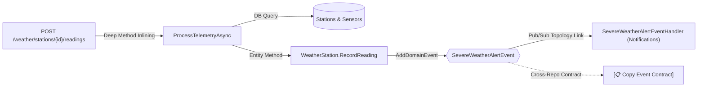

# FlowMap 🗺️

[](LICENSE)
[](https://www.rust-lang.org/)
[](https://dotnet.microsoft.com/)
[](https://www.python.org/)
[](https://github.com/jamp-scp28/FlowMap/releases)

**FlowMap** is a high-precision, autonomous behavioral and architectural mapping engine for **C# (.NET / Roslyn)**, **Rust (syn AST / Diesel / Axum)**, and **Python (FastAPI / Starlette / Celery)** codebases.

---

## Use Cases

### Why I built FlowMap

FlowMap came out of a long iteration at work. I shipped a new feature, and a lot of issues showed up afterwards. Looking back, the root cause was clear: I was asking an AI agent to implement changes without it having the whole picture of the codebase. It saw the files I pointed it to, not the flows, side effects and services those files were connected to.

There are probably existing tools that already cover parts of this, and you can get far by using Roslyn or your IDE's "find references" directly. FlowMap is my attempt to put that information into one map that both a human and an AI agent can read quickly. These are the ways I use it personally:

1. **Keep up with AI-generated code.** AI writes code faster than most of us can review it. Even with a careful review, it's easy to lose track of how the features of a codebase interact. FlowMap turns those interactions (calls, database tables, events, consumers) into a visual map, so you can rebuild your mental model of the system much faster.

2. **Prepare context before building a new feature.** Instead of hunting for the relevant files yourself, or asking the AI to "implement feature X" blindly, generate the flow maps first. The agent can then read the map, understand the relationships and the blast radius of its edits, and check its own work with `flowmap impact`, `flowmap delta` and `flowmap diff`.

3. **Features that span multiple codebases and repos.** When a change crosses service boundaries, ask the agent to evaluate the impact across several maps (`flowmap federate`). It can see which services publish and consume each event before it touches anything, and implement the change consistently on every side.

4. **Onboarding.** Someone new to a codebase can open the map and get a working understanding of its main flows, data and events without reading every file first.

5. **Reviewing pull requests.** `flowmap delta --against main --pr` produces a behavioral summary for the PR description: which flows changed, which outcomes were dropped, which guards were removed. Reviewers see the effect of a change, not only the lines.

6. **Architecture and safety checks.** The audit flags events nobody consumes, state mutations that happen before auth or validation, and unguarded endpoints. `flowmap delta --strict` can run as a CI gate to block breaking behavioral changes.

7. **Answering "what touches this?"** `flowmap query` tells you which flows write to a table, who publishes and consumes an event, or what is gated behind a feature flag. Useful when debugging, or before a schema change or flag cleanup.

### The plan

I'm going to use FlowMap in my day-to-day work and backtest it against real tasks to see whether it actually improves my process and the quality of what I deliver. If it helps, I'll keep using it and improving it. If it doesn't, I'll adapt it, or archive it. Either way, it was fun to build.

> [!IMPORTANT]
> **100% Local-First & Static Analysis Privacy Guarantee**
> FlowMap runs **entirely offline and locally on your machine**. It performs purely static AST analysis (using Roslyn for C# and Syn for Rust) without executing your code, without connecting to external servers, and without transmitting telemetry or source code to third parties.
> 
> * **Zero Remote Data Transfer:** All extracted flow graphs and interactive HTML explorers remain strictly on your local filesystem inside `<repo>/flows/`.
> * **AI Agent Boundaries:** The *only* data transfer that ever occurs is whatever context or flow summaries are explicitly provided to your AI coding agent (e.g., Gemini, Claude, Cursor, Copilot) during conversation.
> * **Secrets & Sensitive Files:** If your repository contains sensitive files or credentials (`.env`, private keys, `appsettings.Production.json`), please ensure you instruct your AI agent to exclude them or maintain them in `.gitignore`. FlowMap itself strictly performs static code syntax extraction and ignores file contents outside of declared code symbols.

---

## Why FlowMap?

Traditional documentation (Swagger, OpenAPI, static class diagrams) treats microservices as black boxes:

* **Swagger tells you:** `POST /weather/stations/{id}/readings` takes a body and returns `200 OK`.
* **FlowMap reveals:** `POST /weather/stations/{id}/readings` calls `_alertService.ProcessTelemetryAsync`, executes database queries across `Stations` and `Sensors`, mutates `WeatherReadings`, calls domain entity `WeatherStation.RecordReading()`, emits `SevereWeatherAlertEvent`, which asynchronously triggers `SevereWeatherAlertEventHandler` in the Notification service, and state-couples with 34 other flows modifying `WeatherReadings`.



---

## Key Capabilities

### 1. Deep Recursive Execution Traversal
- **Interface Resolution (DI & Convention):** Resolves abstract interface dependencies (`IAlertService`) into their concrete implementations and inlines execution blocks recursively.
- **Domain Aggregate Inlining:** Follows method invocations on domain model instances (e.g. `station.RecordReading(...)`) through private helpers to identify state mutations and event dispatches.
- **Entity Type Discovery:** Resolves generic `_dbContext.Add(...)` and Diesel `insert_into(...)` calls to exact table entities.

### 2. Bi-directional Pub/Sub Topology Linking
- **Producers & Consumers:** Maps every flow that publishes an event directly to its consuming handlers (`IEventHandler<T>`, `IConsumer<T>`, background workers).
- **Background Queue Workers:** Discovers Rust outbox queue workers (e.g., `process_once`, `claim_batch`) and links them to asynchronous event topics.
- **Cross-Repo Event Contracts:** When an event has no local registered consumer (e.g., cross-service boundaries), FlowMap marks it as `🟠 External Contract` and renders an interactive **`[📋 Copy Event Contract]`** button that copies a clean JSON contract schema to your clipboard.

### 3. Interactive Visual Architecture Explorer
- **Zero-Dependency Dashboard:** Produces a self-contained, offline `index.html` with dark-mode wireframes, interactive Mermaid diagrams, DTO schemas, and database mutation matrices.
- **Click-to-Flow Navigation:** Click any producer, consumer, or state-coupled table to jump directly to its execution flowbook.

### 4. Automated Behavioral & Architectural Audit
Automatically detects architectural violations before deployment:
- **Dead Event Topics:** Unconsumed domain events published without any registered subscriber.
- **Premature State Mutations:** Database mutations occurring before authorization, authentication, or validation gates.
- **Unguarded Endpoints:** State-mutating routes missing auth or validation checks.

### 5. Pre-Edit Impact Analysis (Blast Radius) & Behavioral Diff
- `flowmap impact`: Computes the ripple effect of editing a file or symbol before touching code (direct calls, coupled database tables, downstream event consumers).
- `flowmap diff`: Compares execution paths before and after a change to detect silently dropped outcomes or removed security guards.

---

## Quick Start

### Installation

Download the prebuilt release binaries from [Releases](https://github.com/jamp-scp28/FlowMap/releases):

```
flowmap/
  ├── flowmap.exe              (Core Engine & Rust AST)
  └── CSharpFlowExtractor.exe  (Standalone Roslyn Single-File Analyzer)
```

Add the folder to your `PATH`, or run directly.

#### Building from Source
Prerequisites: Rust 1.80+ and .NET 9 SDK.

```bash
git clone https://github.com/jamp-scp28/FlowMap.git
cd FlowMap

# Build the Rust CLI
cargo build --release

# Publish the single-file Roslyn extractor into the release folder
dotnet publish extractors/csharp/CSharpFlowExtractor.csproj -c Release -r win-x64 --self-contained false -p:PublishSingleFile=true -o target/release
```

---

## Usage

### 1. One-Step Automated Repository Scan
Scans any C# or Rust project, builds the connected graph, outputs markdown and visual dashboards, and runs the audit:

```bash
flowmap scan /path/to/repository
```

**Artifacts Generated:** All outputs are strictly saved inside `<repo>/flows/` without polluting your source tree:
- `<repo>/flows/FLOWS.md` — Complete Markdown flowbook with Mermaid flowcharts and decision tables.
- `<repo>/flows/index.html` — Interactive visual behavior explorer.
- `<repo>/flows/flowmap.json` — Connected graph dataset.

### 2. Pre-Edit Impact Analysis (Blast Radius)
Run before modifying shared domain entities or repository methods:

```bash
# Check impact of editing a file
flowmap impact --files "Quote.cs"

# Check impact of editing a specific symbol
flowmap impact --symbols "StartDeposit"
```

```

### 3. Feature Branch Behavioral Delta & PR Blast Radius (`flowmap delta`)
When finishing work on a feature branch (`feature/x`), instantly detect behavioral gaps, missing guards, unconsumed events, and secondary blast radius against your base branch without switching branches:

```bash
# Compare current working tree against main (zero checkout, git-native)
flowmap delta --against main

# Generate a Pull Request Markdown report ready for GitHub/GitLab PR descriptions
flowmap delta --against main --pr

# Generate an interactive visual delta explorer
flowmap delta --against main --html

# CI/CD Gate: Fail build if breaking behavioral changes or critical hazards exist
flowmap delta --against main --strict
```

### 4. Low-Level FlowMap File Diff
```bash
# Compare two specific flowmap JSON datasets
flowmap diff baseline.json current.json
```

### 5. Querying Coupled State & Events

```bash
# What flows touch this DB table?
flowmap query --table WeatherReadings

# Who publishes and consumes this event?
flowmap query --event SevereWeatherAlertEvent

# What flows are gated by this feature flag?
flowmap query --flag EnableAdvancedForecasts
```

### 6. Inspecting a Specific Flow
```bash
flowmap show "RecordReading"
```

### 7. Cross-Repository Pub/Sub Mesh Federation (`flowmap federate`)
Stitch together microservices spanning different repositories and languages (C#, Rust, Python) into a unified behavioral topology:

```bash
# Federate multiple microservice repos or flowmaps
flowmap federate ../order-service ../warehouse-service ../notification-service --out federated_flowmap.json

# Query publishers and consumers across repo boundaries
flowmap query --map federated_flowmap.json --event OrderSubmittedIntegrationEvent
```

---

## Architecture & Project Structure

```
FlowMap/
├── src/
│   ├── main.rs                  # CLI command routing (scan, impact, diff, check, build, query, federate)
│   ├── model.rs                 # Core domain graph model (Flow, Coupling, EventCoupling, Steps)
│   ├── linker.rs                # Graph linker, domain inference, event mesh & coupling indexer
│   ├── markdown.rs              # FLOWS.md generator with native Mermaid syntax & decision tables
│   ├── html/
│   │   ├── mod.rs               # HTML generator
│   │   └── template.html        # Interactive Single-Page Visual Behavior Explorer
│   ├── impact.rs                # Blast radius & state coupling analyzer
│   ├── diff.rs                  # Behavioral diff & regression detector
│   ├── check.rs                 # Architectural integrity & behavioral auditor
│   └── extractors/
│       ├── rust.rs              # Native Rust AST extractor (syn, Diesel, Axum, utoipa, workers)
│       ├── csharp.rs            # C# extractor bridge & standalone runner
│       └── python.rs            # Python AST extractor bridge (FastAPI, Celery, EventBus)
├── extractors/
│   └── csharp/                  # Roslyn AST extractor (.NET 9)
│       ├── Program.cs           # Deep method inlining, DI resolution, EF Core & domain event visitor
│       └── CSharpFlowExtractor.csproj
│   └── python/
│       └── extractor.py         # Standard library AST visitor for Python microservices
├── skill/
│   └── SKILL.md                 # Antigravity / AI Agent Pair Programming Skill definition
└── Cargo.toml
```

---

## AI Agent Integration

FlowMap includes an agent skill definition in [`skill/SKILL.md`](skill/SKILL.md). Compatible with:
- **Google Antigravity CLI / IDE**
- **Cursor** / **Windsurf**
- **Claude Code** / **Aider**

When paired with an AI coding agent, FlowMap ensures the agent possesses the complete behavioral mental map of your repository before making changes, preventing broken status transitions, orphaned domain events, or unintended database side-effects.

---

## License

This project is licensed under the [MIT License](LICENSE).
