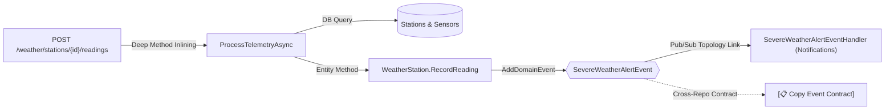

# FlowMap 🗺️

[](LICENSE)
[](https://www.rust-lang.org/)
[](https://dotnet.microsoft.com/)
[](https://github.com/jamp-scp28/FlowMap/releases)

**FlowMap** is a high-precision, autonomous behavioral and architectural mapping engine for **C# (.NET / Roslyn)** and **Rust (syn AST / Diesel / Axum)** codebases.

Instead of stopping at shallow Swagger endpoint definitions, FlowMap performs **deep recursive call-tree inlining**, traverses dependency-injection interfaces, aggregates domain roots, connects asynchronous **Pub/Sub event meshes**, models shared database state coupling, and renders an interactive visual mental map with zero repository pollution.

---

## Why FlowMap?

Traditional documentation (Swagger, OpenAPI, static class diagrams) treats microservices as black boxes:

* **Swagger tells you:** `POST /weather/stations/{id}/readings` takes a body and returns `200 OK`.
* **FlowMap reveals:** `POST /weather/stations/{id}/readings` calls `_alertService.ProcessTelemetryAsync`, executes database queries across `Stations` and `Sensors`, mutates `WeatherReadings`, calls domain entity `WeatherStation.RecordReading()`, emits `SevereWeatherAlertEvent`, which asynchronously triggers `SevereWeatherAlertEventHandler` in the Notification service, and state-couples with 34 other flows modifying `WeatherReadings`.



---

## Key Capabilities

### 1. Deep Recursive Execution Traversal
- **Interface Resolution (DI & Convention):** Resolves abstract interface dependencies (`IAlertService`) into their concrete implementations and inlines execution blocks recursively.
- **Domain Aggregate Inlining:** Follows method invocations on domain model instances (e.g. `station.RecordReading(...)`) through private helpers to identify state mutations and event dispatches.
- **Entity Type Discovery:** Resolves generic `_dbContext.Add(...)` and Diesel `insert_into(...)` calls to exact table entities.

### 2. Bi-directional Pub/Sub Topology Linking
- **Producers & Consumers:** Maps every flow that publishes an event directly to its consuming handlers (`IEventHandler<T>`, `IConsumer<T>`, background workers).
- **Background Queue Workers:** Discovers Rust outbox queue workers (e.g., `process_once`, `claim_batch`) and links them to asynchronous event topics.
- **Cross-Repo Event Contracts:** When an event has no local registered consumer (e.g., cross-service boundaries), FlowMap marks it as `🟠 External Contract` and renders an interactive **`[📋 Copy Event Contract]`** button that copies a clean JSON contract schema to your clipboard.

### 3. Interactive Visual Architecture Explorer
- **Zero-Dependency Dashboard:** Produces a self-contained, offline `index.html` with dark-mode wireframes, interactive Mermaid diagrams, DTO schemas, and database mutation matrices.
- **Click-to-Flow Navigation:** Click any producer, consumer, or state-coupled table to jump directly to its execution flowbook.

### 4. Automated Behavioral & Architectural Audit
Automatically detects architectural violations before deployment:
- **Dead Event Topics:** Unconsumed domain events published without any registered subscriber.
- **Premature State Mutations:** Database mutations occurring before authorization, authentication, or validation gates.
- **Unguarded Endpoints:** State-mutating routes missing auth or validation checks.

### 5. Pre-Edit Impact Analysis (Blast Radius) & Behavioral Diff
- `flowmap impact`: Computes the ripple effect of editing a file or symbol before touching code (direct calls, coupled database tables, downstream event consumers).
- `flowmap diff`: Compares execution paths before and after a change to detect silently dropped outcomes or removed security guards.

---

## Quick Start

### Installation

Download the prebuilt release binaries from [Releases](https://github.com/jamp-scp28/FlowMap/releases):

```
flowmap/
  ├── flowmap.exe              (Core Engine & Rust AST)
  └── CSharpFlowExtractor.exe  (Standalone Roslyn Single-File Analyzer)
```

Add the folder to your `PATH`, or run directly.

#### Building from Source
Prerequisites: Rust 1.80+ and .NET 9 SDK.

```bash
git clone https://github.com/jamp-scp28/FlowMap.git
cd FlowMap

# Build the Rust CLI
cargo build --release

# Publish the single-file Roslyn extractor into the release folder
dotnet publish extractors/csharp/CSharpFlowExtractor.csproj -c Release -r win-x64 --self-contained false -p:PublishSingleFile=true -o target/release
```

---

## Usage

### 1. One-Step Automated Repository Scan
Scans any C# or Rust project, builds the connected graph, outputs markdown and visual dashboards, and runs the audit:

```bash
flowmap scan /path/to/repository
```

**Artifacts Generated:** All outputs are strictly saved inside `<repo>/flows/` without polluting your source tree:
- `<repo>/flows/FLOWS.md` — Complete Markdown flowbook with Mermaid flowcharts and decision tables.
- `<repo>/flows/index.html` — Interactive visual behavior explorer.
- `<repo>/flows/flowmap.json` — Connected graph dataset.

### 2. Pre-Edit Impact Analysis (Blast Radius)
Run before modifying shared domain entities or repository methods:

```bash
# Check impact of editing a file
flowmap impact --files "Quote.cs"

# Check impact of editing a specific symbol
flowmap impact --symbols "StartDeposit"
```

### 3. Post-Edit Regression Diff ("Did I Break Anything?")
Verify behavioral fidelity after refactoring:

```bash
# Compare a baseline graph against a newly extracted graph
flowmap diff baseline.json current.json
```

### 4. Querying Coupled State & Events

```bash
# What flows touch this DB table?
flowmap query --table WeatherReadings

# Who publishes and consumes this event?
flowmap query --event SevereWeatherAlertEvent

# What flows are gated by this feature flag?
flowmap query --flag EnableAdvancedForecasts
```

### 5. Inspecting a Specific Flow
```bash
flowmap show "RecordReading"
```

---

## Architecture & Project Structure

```
FlowMap/
├── src/
│   ├── main.rs                  # CLI command routing (scan, impact, diff, check, build, query)
│   ├── model.rs                 # Core domain graph model (Flow, Coupling, EventCoupling, Steps)
│   ├── linker.rs                # Graph linker, domain inference, event mesh & coupling indexer
│   ├── markdown.rs              # FLOWS.md generator with native Mermaid syntax & decision tables
│   ├── html/
│   │   ├── mod.rs               # HTML generator
│   │   └── template.html        # Interactive Single-Page Visual Behavior Explorer
│   ├── impact.rs                # Blast radius & state coupling analyzer
│   ├── diff.rs                  # Behavioral diff & regression detector
│   ├── check.rs                 # Architectural integrity & behavioral auditor
│   └── extractors/
│       ├── rust.rs              # Native Rust AST extractor (syn, Diesel, Axum, utoipa, workers)
│       └── csharp.rs            # C# extractor bridge & standalone runner
├── extractors/
│   └── csharp/                  # Roslyn AST extractor (.NET 9)
│       ├── Program.cs           # Deep method inlining, DI resolution, EF Core & domain event visitor
│       └── CSharpFlowExtractor.csproj
├── skill/
│   └── SKILL.md                 # Antigravity / AI Agent Pair Programming Skill definition
└── Cargo.toml
```

---

## AI Agent Integration

FlowMap includes an agent skill definition in [`skill/SKILL.md`](skill/SKILL.md). Compatible with:
- **Google Antigravity CLI / IDE**
- **Cursor** / **Windsurf**
- **Claude Code** / **Aider**

When paired with an AI coding agent, FlowMap ensures the agent possesses the complete behavioral mental map of your repository before making changes, preventing broken status transitions, orphaned domain events, or unintended database side-effects.

---

## License

This project is licensed under the [MIT License](LICENSE).
